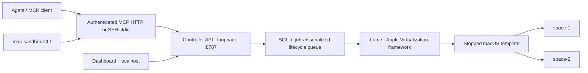

# Mac Sandbox Control

**Run macOS VMs on your own Apple-silicon Mac, controlled by an API, MCP, or CLI.**

A small reference implementation for turning a spare Mac into an agent-driven development machine: create a workspace, run commands, inspect its state, and connect to its desktop when needed.

> **Trusted development only.** These are virtual machines, not a secure multi-tenant execution service. Guest-to-host/LAN isolation is **not implemented**. Each MCP token can administer every managed VM. Read [SECURITY.md](SECURITY.md) before running it.

```sh
mac-sandbox ls
mac-sandbox ps
mac-sandbox exec space-1 -- sw_vers
mac-sandbox exec space-1 -- 'cd /tmp && pwd && whoami'
mac-sandbox exec space-1 --timeout 300 --json -- 'your-test-command'
```

```text
NAME     STATE    ACTIVE  EXEC  CPU  MEMORY  DISK
space-1  RUNNING  yes     yes   8    14 GB   150 GB
space-2  STOPPED  no      no    8    14 GB   150 GB
```

## What is here

- **API-first lifecycle:** create, start, graceful stop, force kill, and confirmed deletion.
- **MCP:** the same operations, command execution, job waiting, desktop addresses, and guest logins.
- **CLI:** `ls`, `ps`, `status`, and `exec`, including stdout/stderr separation and guest exit codes.
- **macOS 27 / Golden Gate notes:** a repeatable template factory using an Apple-created working account, with first-login fixes inspired by upstream Lume PR #4027.
- **A compact dashboard:** localhost-only; use an SSH tunnel when viewing from another computer.
- **Optional remote desktop:** Lume's VNC viewer with one port and password per VM. Disabled by default.
- **Persistent state:** SQLite jobs, conservative crash recovery, key pinning, and private per-VM credentials.

Not implemented: per-VM user permissions, exclusive reservations, hostile-guest network containment, snapshots, TTL cleanup, automatic restart after a host reboot, or an MCP screenshot/click tool.

## Architecture



The MCP server calls the API; it does not invent a second VM lifecycle. The API owns managed VM names and refuses operations on unrelated VMs or the template. Shell commands run in a guest over its pinned SSH key, not in a host shell.

There are at most **two active macOS guests** per host in this implementation. The controller counts other Lume guests and pending reservations too. The default shape is **8 vCPUs, 14 GiB RAM, and a 150 GiB sparse virtual disk** per VM, with at least 6 GiB reserved for the host. Two default guests therefore need at least 34 GiB total RAM; a 36 GiB or larger host is the practical minimum for that exact shape. Free-space checks are not disk quotas.

## Start here

### 1. Prepare the host

Use a dedicated Apple-silicon Mac, macOS 27 for the Golden Gate path, Node.js **24+**, Git, and pnpm. Lume **0.6.1** was the prototype baseline; newer versions require revalidation. `/usr/bin/expect`, SSH, and the normal macOS account tools are used for provisioning.

Install Lume from its [official instructions](https://cua.ai/docs/lume/quickstart). Do not run the controller or Lume as root. No Xcode build of Lume is required.

```sh
git clone https://github.com/different-ai/mac-sandbox-control.git
cd mac-sandbox-control
pnpm test

mkdir -p "$HOME/.config/mac-sandbox-control"
cp .env.example "$HOME/.config/mac-sandbox-control/host.env"
chmod 600 "$HOME/.config/mac-sandbox-control/host.env"
# Review host.env. Keep the MCP bind address at 127.0.0.1 initially.
pnpm host:install
```

The installer registers local commands and writes user LaunchAgents. It **does not download an OS, start VMs, or enable a network listener**. It refuses to replace unrelated files. Keep the repository at its installed path because the commands reference that checkout.

### 2. Build a template

On a trusted, isolated setup network, obtain an Apple restore image compatible with your host. `latest` can change OS versions: inspect the returned Apple URL and use a specific local macOS 27 IPSW if you need Golden Gate.

```sh
mkdir -p "$HOME/Downloads"
IPSW_URL="$(lume ipsw | tail -n 1)"
curl --fail --location --continue-at - --retry 3 \
  "$IPSW_URL" -o "$HOME/Downloads/macos-restore.ipsw"

pnpm template:create --ipsw "$HOME/Downloads/macos-restore.ipsw"
```

The factory uses Lume's temporary bootstrap account only to create a proper `spaceuser` account using Apple's tools. It installs pinned key-only SSH, applies guest-version-specific first-login preferences, disables the incomplete bootstrap account, and leaves the template stopped. It refuses an existing template name instead of overwriting VM data.

**Read [the macOS 27 provisioning guide](docs/golden-gate.md) first.** Lume's upstream unattended bootstrap can temporarily start its own VNC listener during setup. Loopback defaults in this project do not override that upstream behavior. A failed or interrupted factory is not automatically retried.

### 3. Start the services and create access

```sh
pnpm host:start
sandbox-mcp-token add operator
```

Save the token in a password manager. It is displayed once; only a hash is stored in the token registry. On the host, set `MAC_SANDBOX_TOKEN` in the current process or provide `MAC_SANDBOX_TOKEN_FILE` pointing at a private token file. Do not commit either value.

```sh
mac-sandbox ls
sandbox create space-1
# Creation returns a job. Inspect it with sandbox status JOB_ID, or use MCP wait_for_job.
mac-sandbox exec space-1 -- sw_vers
```

For another Mac, use [the client and Tailscale guide](docs/networking.md), not the host's administrator SSH credentials.

## MCP tools

| Tool | Purpose |
| --- | --- |
| `list_sandboxes` | State and capacity; optional `status: all / active / running / stopped` |
| `create_sandbox` | Clone and provision a VM, then start it; returns a job |
| `start_sandbox` | Start a stopped, provisioned VM; returns a job |
| `stop_sandbox` | Graceful shutdown, retaining files; returns a job |
| `kill_sandbox` | Immediate power-off; unsaved work can be lost |
| `delete_sandbox` | Delete a stopped VM; requires its exact name as confirmation |
| `get_job` / `wait_for_job` | Observe an operation without repeating it |
| `run_command` | Guest shell command, stdout/stderr, exit code and timeout status |
| `connection_info` | Desktop URL when desktop access is explicitly enabled |
| `get_login` | Sensitive desktop and macOS account credentials |

Example agent flow:

```text
list_sandboxes(status="all")
create_sandbox(name="space-1")
wait_for_job(job_id="<returned-job-id>")
list_sandboxes(status="running")
run_command(name="space-1", command="sw_vers")
```

A queued start is **not** a running VM. `ready=true` means credential setup completed; `active` and `canExec` describe whether it is in use and eligible for commands. Unknown state is never silently reported as stopped.

See [MCP client examples](docs/mcp.md), [REST and CLI reference](docs/api.md), and [how the implementation fits together](docs/architecture.md).

## Security defaults

- Controller API: `127.0.0.1:8787` only.
- MCP HTTP: `127.0.0.1:8788` by default, bearer token required. Put HTTPS/Tailscale Serve or an SSH tunnel in front of it.
- Remote desktop: **off by default**. Opt-in VNC uses legacy eight-character passwords and Lume may bind every host interface. An encrypted tunnel does not itself close the direct listener.
- Guest commands run as an administrator and may use passwordless `sudo`. Never give a token to someone you would not trust with all guest data and machines on the reachable network.
- Runtime data stays outside the checkout. Do not attach its directory to public bug reports.

[SECURITY.md](SECURITY.md) explains the boundaries, plaintext-at-rest credentials, auto-login tradeoffs, and unsafe deployment patterns.

## Development and verification

```sh
pnpm test
pnpm check:public
```

The ordinary tests use fake Lume processes and temporary state. They do not install an OS, access a personal keychain, connect to a private host, or prove a real VM works. For real-Mac verification use [the smoke-test checklist](docs/verification.md).

The original prototype was exercised with macOS 27.0.1 guests: credential rotation, guest command execution, lifecycle operations, MCP over a LAN, and framebuffer capture using `vncdotool`. This public packaging adds safer defaults and installation helpers; **those changes still need a clean-machine macOS smoke test**. Linux CI cannot prove Apple Virtualization, Screen Sharing, or macOS licensing compatibility.

## License and upstream work

MIT. Lume, macOS, Tailscale, and MCP clients have their own licenses and requirements. This repository does not distribute macOS, a restore image, Lume binaries, or another party's credentials.

Thanks to [Lume / Cua](https://github.com/trycua/cua) and its [Golden Gate first-login investigation, PR #4027](https://github.com/trycua/cua/pull/4027). See [THIRD_PARTY_NOTICES.md](THIRD_PARTY_NOTICES.md) for attribution and [the Golden Gate guide](docs/golden-gate.md) for the distinction between the upstream proposal and this reference implementation.
